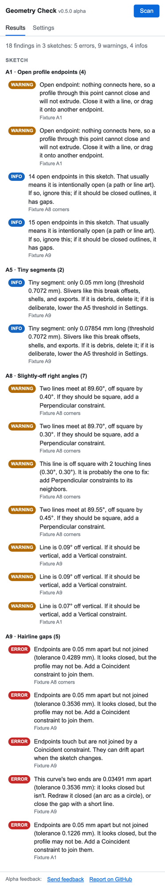
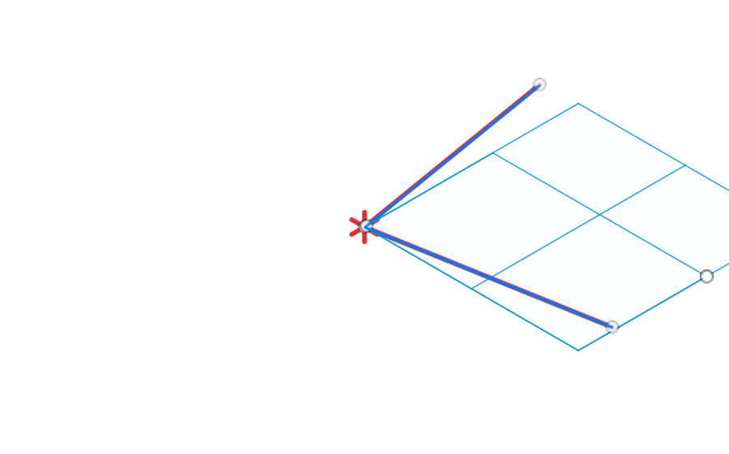

# Geometry Check

**A free Fusion 360 add-in that finds geometry that is *slightly* wrong — and shows you exactly where.**

A line 0.3° off square, so the parts don't quite fit. Two endpoints 0.05 mm apart, so the profile looks closed but won't extrude. A sliver segment left over from an import, so the offset fails. You can lose an evening zooming into endpoints hunting for these. Geometry Check finds them in one click, explains each one in plain language, and jumps the camera to it.

> **Public alpha.** It works on real designs, but expect rough edges — and please tell us about them:
> **[Send feedback (2 minutes, anonymous)](https://tally.so/r/eq1VVE)** or [open a GitHub issue](https://github.com/andyd/geometry-check/issues/new/choose).

<p align="center"> </p>

## What it catches

| ID | Check | What it finds |
|----|-------|---------------|
| A8 | **Slightly-off right angles** | Lines within 0.5° of square but not exactly square — "it looked vertical, but it was off by a tiny amount." No other tool checks this. |
| A9 | **Hairline gaps** | Endpoints a fraction of a millimetre apart, endpoints that touch but aren't constrained together, curves that almost close on themselves. The reason a sketch "won't extrude." |
| A1 | **Open profile endpoints** | Endpoints connected to nothing — the clearly-open case. |
| A5 | **Tiny segments** | Sliver curves far below the sketch's scale that break offsets, shells, and exports. |

Every tolerance is tunable in Settings. Construction and projected geometry are excluded. More checks (duplicate curves, self-intersections, body/topology problems) are on the roadmap.

## Two modes

- **Detect only** (default): finds problems and shows you where they are. Never changes your geometry.
- **Experimental fixes** (opt-in in Settings): adds a **Fix** button that applies the right constraint as a single undo step, then *re-checks the sketch*. If the problem is still there, a new one appeared, or a feature stops rebuilding, the fix is undone automatically and the panel tells you why. Untested in the wide world yet — save your design first.

**Ignore**: some near-misses are deliberate (a draft angle, an intentionally open path). One click marks a finding as intentional and hides it from every future scan. The mark is saved inside the design file — metadata only, no geometry change — and can be restored any time from "show ignored."

## Install

1. Download the latest `GeometryCheck-vX.Y.Z.zip` from [Releases](https://github.com/andyd/geometry-check/releases) and unzip it (you get a `GeometryCheck` folder). Or clone this repo.
2. In Fusion: **Utilities → Add-Ins → Scripts and Add-Ins**, click **+** next to *My Add-Ins*, pick the `GeometryCheck` folder.
3. Select **GeometryCheck**, click **Run** (tick *Run on Startup* if you like).

Three commands appear under **Inspect** in the Design workspace:

- **Geometry Check: Scan** — check every sketch in the design and open the results panel.
- **Geometry Check: Diagnose Selection** — check only the selected sketches or sketch entities.
- **Geometry Check: Settings** — enable/disable checks, tune tolerances, switch modes.

Click a finding to select its entities, draw a red marker, and zoom to it.

**Windows:** developed and verified on macOS; nothing platform-specific found in an audit, but Windows is untested. If you run Windows, trying Scan and [telling us what happened](https://tally.so/r/eq1VVE) is the single most useful thing an alpha tester can do.

## Feedback

This alpha exists to learn what's noisy, what's missing, and what breaks.

- **[Feedback form](https://tally.so/r/eq1VVE)** — two minutes, anonymous, no account. (The panel's *Send feedback* link fills in your version automatically.)
- **[GitHub issues](https://github.com/andyd/geometry-check/issues/new/choose)** — templates for bugs, false alarms / missed problems, and fixes that went wrong.
- **Email** — [geometrychecker@rabid.co](mailto:geometrychecker@rabid.co)

**Privacy:** Geometry Check sends nothing anywhere. No telemetry, no accounts. Feedback is only what you choose to submit.

## Which build am I running?

The panel title shows the running version (e.g. `Geometry Check v0.6.0 alpha`), read from `GeometryCheck.manifest` at load. If it shows an older number than the manifest on disk, Fusion is running stale code: Stop and Run the add-in, or restart Fusion.

## For developers

**Tests:** `tests/run_fixtures.py` builds one broken sketch per check — plus decoys that must *not* be flagged — runs them through the real registry and scanner, and asserts the results, including that every offered fix applies and verifies. It runs inside Fusion (add `tests/` in the Scripts dialog, or exec it with `REPO` set).

**Adding a check** is ~50 lines:

1. Create `GeometryCheck/checks/<category>/<id>_<slug>.py`:

```python
from ..base import Finding

id = 'A5'
name = 'Tiny segments'
category = 'sketch'          # sketch | body (sketch findings list first)
severity = 'warning'         # error | warning | info
scope = 'sketch'
params = {'len_pct': (0.1, 'Max length (% of sketch diagonal)', (0.01, 1.0, 0.01))}  # optional; slider

def detect(ctx):
    # ctx.sketches, ctx.params, ctx.to_world(sketch, pt) -> [x, y, z], ctx.fmt_len(cm)
    return [Finding(id, severity, 'plain-language message', [entities],
                    {'center': [x, y, z], 'extent': cm, 'segments': [[p, q]]})]
```

2. Register it in `GeometryCheck/checks/registry.py`.
3. Add a fixture and its expected messages to `tests/run_fixtures.py`.

See `CLAUDE.md` for architecture notes and hard-won Fusion API pitfalls.

## License

MIT
